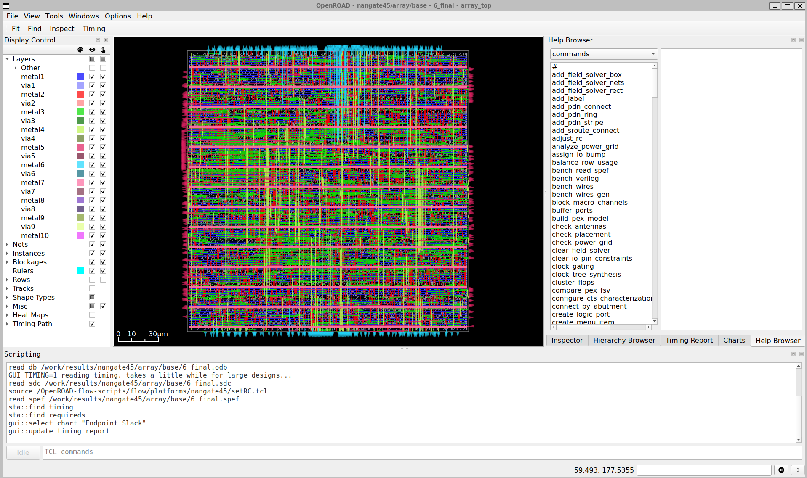
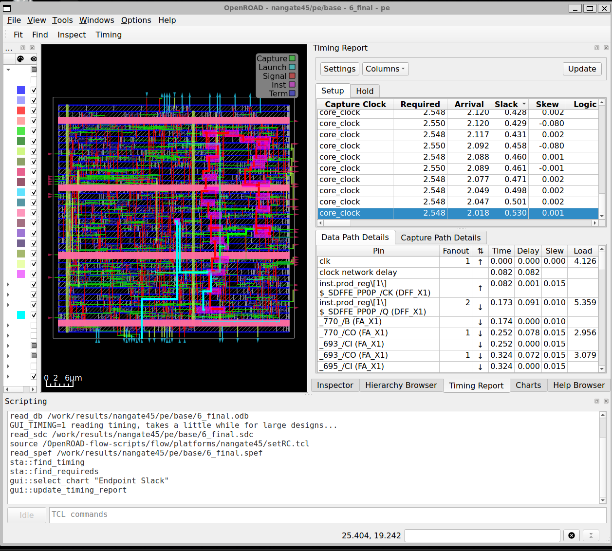
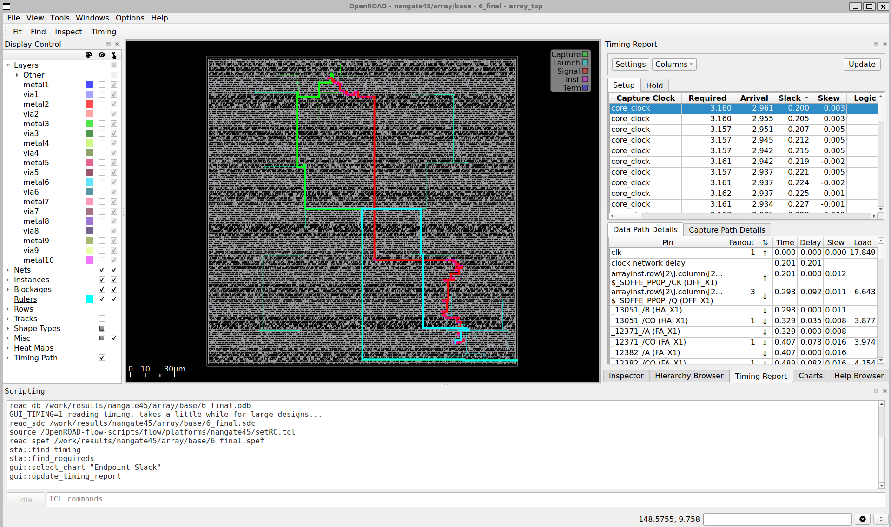

# NxN Systolic Array | SystemVerilog

A parameterized NxN systolic array for signed 8-bit matrix multiplication, designed and implemented in SystemVerilog and taken from RTL to a routed chip layout. The array multiplies two NxN matrices using a grid of N² processing elements (PEs), each built around a pipelined multiply-accumulate (MAC) unit. A single parameter, `N`, sets the array size.

The datapath's additions are built from my own full-adder and ripple-carry adder modules, and the signed 8-bit multiplier is a shift-and-add design rather than Verilog's built-in `*` operator. The one exception is the `+ 1` used to negate the multiplier's final partial product.

The array sits behind a **valid/ready streaming interface** with a skid buffer, so it tolerates input stalls and output backpressure. The full design was then taken through an **RTL-to-GDS flow with OpenROAD** on the Nangate45 (45 nm) library. See [Physical Design](#physical-design-rtl-to-gds).

The RTL uses ANSI-style ports with `logic` and `always_ff`. The core datapath modules are lint-clean in Vivado, and every remaining lint message is a documented, intentional waiver.

This project builds on my previous [8-bit ALU](https://github.com/AlexanderMBell/8-bit-ALU-Verilog) and is my first sequential, clocked digital design.



## What It Does

The array computes:

```
C = A × B
```

where `A` and `B` are NxN matrices of signed 8-bit integers.

The top-level module, `array_top`, has a valid/ready interface on both sides:

| Port | Width | Description |
|------|-------|-------------|
| `clk` | 1 | Clock |
| `rst` | 1 | Synchronous reset: clears every register in the design |
| `in_valid` | 1 | The sender has a beat on `a` and `b` (one skewed slice of the input matrices) |
| `in_ready` | 1 | The array can accept a beat. A beat transfers on any cycle where `in_valid && in_ready` |
| `a` | N × 8-bit | One value per row of `A` for this beat |
| `b` | N × 8-bit | One value per column of `B` for this beat |
| `out_valid` | 1 | `c` holds a finished result |
| `out_ready` | 1 | The reader accepts the result. On `out_valid && out_ready`, the accumulators clear for the next matrix |
| `c` | N × N × 32-bit | Result matrix |

| Parameter | Default | Description |
|-----------|---------|-------------|
| `N` | 4 | Array dimension (number of PE rows and columns) |

Each output element is the sum of N signed 8-bit × 8-bit products. Every product fits in 16 bits, and the 32-bit accumulators cannot overflow for any array up to N = 131,071.

## Architecture

The design is modular and built bottom-up, with each level instantiating the one below it.

### 1. Full Adder and Ripple-Carry Adders
- A gate-level full adder built from XOR, AND, and OR operations.
- 16-bit and 32-bit ripple-carry adders built by chaining full adders with a `generate` loop.

### 2. Signed 8-Bit Multiplier
- A shift-and-add multiplier for two's-complement signed inputs.
- The multiplicand is sign-extended to 16 bits, and each bit of the multiplier selects a shifted copy of it as a partial product.
- Because the MSB of a two's-complement number has a weight of −2⁷, the final partial product is negated (two's complement) instead of added directly. I chose this sign-extension method over taking absolute values and fixing the sign afterward.
- The eight partial products are summed with seven 16-bit ripple-carry adders arranged as a **3-level adder tree** (8 → 4 → 2 → 1), rather than a 7-deep chain, which shortens the critical path.

### 3. Multiply-Accumulate (MAC) Unit
- A **two-stage pipeline**:
  - **Stage 1:** multiply the two 8-bit inputs and register the 16-bit product (`prod_reg`).
  - **Stage 2:** sign-extend the registered product to 32 bits and add it to the accumulator using the 32-bit adder.
- `valid` is delayed one cycle (`valid_delay`) so it stays aligned with the product it describes.
- `clear` zeroes the accumulator and kills any product still in the pipeline, so it can't leak into the next sum. It takes priority over the clock enable, so the array can be cleared while frozen.
- A clock enable, `en`, freezes every register when no data is moving.

### 4. Processing Element (PE)
- Wraps a MAC unit with two output registers.
- Each cycle, a PE multiplies the `A` value from its left neighbor and the `B` value from its top neighbor, then registers both values and passes them to its right and bottom neighbors on the next cycle.
- Because each partial sum stays inside its PE, the array uses an **output-stationary** dataflow.

### 5. NxN Array
- Nested `generate` loops instantiate N² PEs and wire them into a grid, with `A` values flowing left-to-right and `B` values flowing top-to-bottom.
- Each PE's accumulator connects directly to its element of the output matrix `c`.

```
              b[0]         b[1]               b[N-1]
                ↓            ↓                   ↓
a[0]    →   [PE 0,0]   → [PE 0,1]   → ... → [PE 0,N-1]
                ↓            ↓                   ↓
a[1]    →   [PE 1,0]   → [PE 1,1]   → ... → [PE 1,N-1]
                ↓            ↓                   ↓
               ...          ...                 ...
                ↓            ↓                   ↓
a[N-1]  →  [PE N-1,0]  → [PE N-1,1]  → ... → [PE N-1,N-1]
```

### 6. Streaming Interface (`array_top`)
The core array assumes a new input every cycle and a reader that takes `c` at exactly the right moment. `array_top` removes both assumptions:

```
 sender --{b,a}--> [ skid buffer ] --> [ NxN array ] --c--> reader
         valid/ready                     ^   en              valid/ready
                                  one global enable
```

- **Skid buffer:** all 2N edge values travel together as one 2·N·8-bit beat through a parameterized skid buffer. Both its data and ready outputs are registered, so neither direction creates a long combinational path. Its spare slot catches the one beat already in flight when the array stalls.
- **One handshake, one enable:** the PEs never handshake with each other. They stay in lockstep, and a single enable, `en = skid_valid && !out_valid`, freezes every register in the array whenever no beat is available. This keeps the input skew intact through any number of stall cycles.
- **Beat counter:** counts accepted beats, not clock cycles, and raises `out_valid` after 3N − 1 beats.
- **Result handshake:** `c` is held until the reader asserts `out_ready`, then `clear` zeroes the accumulators for the next matrix. Any beats that arrived for the next matrix wait safely in the skid buffer.

## Input Scheduling and Timing

The array expects its inputs to be skewed in time: row *i* of `A` is fed in *i* beats late, and column *j* of `B` is fed in *j* beats late, with zeros on any edge input that has no data yet. Combined with the one-cycle register delay in each PE, this makes `A[i][k]` and `B[k][j]` arrive at PE(*i*, *j*) on the same beat, *i + j + k*.

The last pair meets at PE(N−1, N−1) on beat 3(N − 1). Counting from beat 0, that is 3N − 2 beats to multiply every pair. The MAC pipeline adds one more before the last product reaches its accumulator, so a full NxN matrix multiplication takes **3N − 1 beats**: 3N − 1 clock cycles when no stalls occur. Doing the same work with a single MAC unit would take N³ cycles, since the array performs up to N² multiplications in parallel.

| N | PEs | Array Cycles (3N − 1) | Single-MAC Cycles (N³) |
|---|-----|-----------------------|------------------------|
| 2 | 4 | 5 | 8 |
| 4 | 16 | 11 | 64 |
| 8 | 64 | 23 | 512 |
| 16 | 256 | 47 | 4,096 |

## Timing Results (FPGA)

Synthesized out-of-context in Vivado for an Artix-7 (`xc7a12ticsg325-1L`) at N = 4, with a 10 ns (100 MHz) clock constraint. Figures are post-synthesis estimates.

| Version | WNS | Critical Path | Fmax |
|---------|-----|---------------|------|
| Original (7-adder ripple chain) | −4.587 ns | 14.59 ns | 68.6 MHz |
| Adder tree (3 levels) | −1.921 ns | 11.92 ns | 83.9 MHz |
| Pipelined MAC | +2.286 ns | 7.71 ns | **129.6 MHz** |

Static timing analysis showed the original critical path ran from a neighboring PE's `A_out` register, through the full multiplier, and up the 32-bit accumulator adder. Restructuring the multiplier as an adder tree shortened that path by 18%, and pipelining the MAC split it across two cycles, for a 1.9× total improvement in Fmax at the cost of one extra cycle of latency.

## Physical Design (RTL-to-GDS)

The PE and the full 4×4 array (`array_top`) were taken from RTL to a routed layout with [OpenROAD-flow-scripts](https://github.com/The-OpenROAD-Project/OpenROAD-flow-scripts), using the open Nangate45 (45 nm) standard-cell library. The flow is the ORFS default: Yosys synthesis, floorplan, placement, clock tree synthesis, routing, and post-route timing and power analysis. The design configs, SDC constraints, reports and full write-up are in [`pd/`](pd/). See [`pd/RESULTS.md`](pd/RESULTS.md).

### Results (post-route, typical corner)

| Design | Clock constraint | Fmax | Cell area | Power |
|---|---|---|---|---|
| PE | 2.5 ns | **403 MHz** | 1,064 µm² | 0.45 mW at 400 MHz |
| 4×4 array | 3.0 ns | **357 MHz** | 17,360 µm² | 4.90 mW at 333 MHz |

- The same RTL reaches 129.6 MHz on the Artix-7 FPGA, so the 45 nm layout runs about 3× faster.
- The 4×4 array is about 0.2 × 0.2 mm. Signal routing uses metal2 through metal6, about 10 cm of wire in total.
- Fmax was found by sweeping the clock constraint. The PE passes at 5.0 ns, fails at 2.0 ns (−0.44 ns slack), and passes at 2.5 ns (+0.02 ns slack).
- About 90% of the array's power goes to the flip-flops and the clock tree, which makes clock gating the obvious power optimization.

### Critical path

In both designs the critical path is the **32-bit ripple-carry accumulator** in the MAC, from `acc[0]` to `acc[31]`. Synthesis mapped the gate-level adder onto the library's full-adder cells. At 2.5 ns the carry passes through one half adder and 30 `FA_X1` cells at about 73 ps each, which accounts for about 2.2 ns of the 2.52 ns path.



The array is slightly slower than the single PE. The critical logic is the same carry chain, but the array's clock tree and wires are longer (0.20 ns vs 0.08 ns of clock network delay).



## Project Structure

| File | Module | Description |
|------|--------|-------------|
| `full_adder.sv` | `full_adder` | Gate-level 1-bit full adder |
| `adder_16bit.sv` | `adder_16bit` | 16-bit ripple-carry adder |
| `adder_32bit.sv` | `adder_32bit` | 32-bit ripple-carry adder |
| `sig_mult_8bit.sv` | `sig_mult_8bit` | Signed 8-bit shift-and-add multiplier with a 3-level adder tree |
| `MAC.sv` | `mac` | Two-stage pipelined multiply-accumulate unit with 32-bit accumulator |
| `PE.sv` | `pe` | Processing element: MAC plus pass-through registers |
| `NbyN_Systolic_Array.sv` | `nxn_systolic_array` | Parameterized NxN array |
| `skid_buffer.sv` | `skid_buffer` | Parameterized valid/ready skid buffer |
| `pipe_stage.sv` | `pipe_stage` | Basic valid/ready pipeline stage (the starting point for the skid buffer) |
| `array_top.sv` | `array_top` | Top level: streaming interface, skid buffer, enable, and beat counter |
| `sig_mult_8bit_tb.sv` | `sig_mult_8bit_tb` | Exhaustive signed multiplier testbench |
| `MAC_tb.sv` | `mac_tb` | MAC testbench |
| `pe_tb.sv` | `pe_tb` | PE testbench |
| `array_tb_sc.sv` | `array_tb_sc` | Self-checking full-array testbench |
| `pipe_stage_tb.sv` | `pipe_stage_tb` | Directed pipe stage testbench |
| `skid_buffer_tb.sv` | `skid_buffer_tb` | Directed skid buffer testbench |
| `array_top_tb.sv` | `array_top_tb` | Stall and backpressure testbench for `array_top` |
| `pd/` | | OpenROAD configs, SDC constraints, reports, screenshots, and `RESULTS.md` |

## Verification

### Signed Multiplier: Exhaustive Testing

The multiplier testbench applies all 65,536 signed 8-bit input pairs (−128 to 127 for each input) and compares every product against the expected result. All 65,536 products are correct, including the edge case −128 × −128 = 16,384.

### MAC and PE: Directed Testing

The MAC and PE testbenches apply a sequence of inputs and check the accumulated result after each clock cycle, accounting for the one-cycle pipeline latency. They cover:
- Reset behavior
- Accumulating positive, negative, and mixed-sign products (2 × 3, −4 × 5, −3 × −6)
- Holding the accumulator when `valid` is low
- Clearing the accumulator with `clear`, including clearing while valid data is on the inputs (the in-flight product must not leak into the new sum)
- Forwarding `A` and `B` to the PE outputs one cycle later

### Full Array: Self-Checking Regression

The array testbench is parameterized by the same `N` as the design, so one value sets the size of the array, the edge inputs, the matrices, and the test. A reusable task runs one complete multiplication:
1. Computes the expected result with a textbook triple-loop matrix multiply (the reference model)
2. Pulses `clear` so each test starts from zero, which also tests `clear` between back-to-back runs
3. Generates the skewed input schedule automatically: on cycle *t*, row *i* receives `A[i][t − i]` and column *j* receives `B[t − j][j]`, or zero when that index is out of range
4. Compares all N² outputs against the expected result and counts mismatches

The regression runs a fixed base pattern followed by 1,000 random signed matrices (values from −128 to 127). Result: **1,001 tests, 0 errors** at N = 8.

### Handshake Interface: Stall and Backpressure Testing

The pipe stage and skid buffer each have a directed testbench that walks through accept, stall, refill and drain cycles.

The `array_top` testbench plays a slow sender and a busy reader around the full array:
- **The sender** randomly inserts idle cycles before each beat. Once it offers a beat, it holds `a`, `b` and `in_valid` steady until the beat is accepted.
- **The reader** randomly lowers `out_ready`, so finished results must wait.
- **A queue of expected results** keeps the checks in order, because the sender can start pushing the next matrix while the reader still holds the previous result.
- **A watchdog** ends the test if a beat or result is ever lost and the test deadlocks.

Result: **1,001 matrices, 0 errors** at N = 4 and N = 8, including runs with the sender idle 50% of the time and the reader ready only 20% of the time. Breaking the design on purpose shows the testbench catches real bugs: removing the PE freeze produces thousands of errors, and ignoring the array's ready signal produces errors and lost results.

### In Progress

- [ ] **Multiple sizes:** run the core-array regression at N = 2 and N = 4
- [ ] **Edge cases:** identity, zero, and maximum-magnitude (−128) matrices

## Running the Project

**Simulation**
1. Open the source files in a simulator that supports SystemVerilog (the design uses packed multidimensional arrays).
2. Include all design files: `full_adder.sv`, `adder_16bit.sv`, `adder_32bit.sv`, `sig_mult_8bit.sv`, `MAC.sv`, `PE.sv` and `NbyN_Systolic_Array.sv`, plus `skid_buffer.sv` and `array_top.sv` for the streaming top level.
3. Include the testbench you want to run, select it as the simulation top-level module, and set `parameter N` at the top of the array testbenches to choose the size.
4. Run the simulation to completion (`run all`) and check the printed `Tests run / Errors` summary.

**Physical design**

From an [OpenROAD-flow-scripts](https://github.com/The-OpenROAD-Project/OpenROAD-flow-scripts) checkout, using its Docker image:

```bash
cd OpenROAD-flow-scripts/flow
mkdir -p designs/src/pe designs/nangate45/pe
cp <this-repo>/{full_adder,adder_16bit,adder_32bit,sig_mult_8bit,MAC,PE}.sv designs/src/pe/
cp <this-repo>/pd/pe/config.mk <this-repo>/pd/pe/constraint.sdc designs/nangate45/pe/
util/docker_shell make DESIGN_CONFIG=/work/designs/nangate45/pe/config.mk
```

`util/docker_shell` mounts the `flow` directory at `/work` inside the container, which is why the config paths use `/work` and `$(WORK_HOME)`. The array works the same way with the files in `pd/array/`.

## What I Learned

Through this project, I gained practical experience with:

- Sequential logic, clocking, and registers
- Synchronous reset, clear, and clock-enable control signals
- Building a signed multiplier from adders and partial products
- Two's-complement signed arithmetic and sign extension
- Choosing datapath widths to prevent overflow
- Multiply-accumulate units and how they underpin matrix math
- Systolic array dataflow and input skewing
- Parameterized RTL and nested `generate` loops
- Modern SystemVerilog style (ANSI ports, `logic`, `always_ff`) and linting
- Self-checking testbenches with randomized tests and a reference model
- Valid/ready handshakes, backpressure, and skid buffers
- Testing for stalls and deadlocks, and checking that a testbench actually catches bugs
- Static timing analysis: clock constraints, WNS/TNS, and critical paths
- Improving Fmax with logic restructuring (adder trees) and pipelining, and keeping control signals aligned with pipelined data
- The RTL-to-GDS flow: synthesis, floorplanning, placement, clock tree synthesis, and routing
- Writing SDC constraints and reading post-route timing, area, and power reports
- PPA trade-offs: tighter clocks cost area and power

Most importantly, this project showed me how the matrix multiplication at the core of machine learning hardware, like Google's TPU, is built from the same full adders as my first ALU, and let me trace a design decision all the way down to picoseconds of delay in a real layout.

## Next Steps

- Closing timing on the PE at 500 MHz with a faster accumulator (a synthesis-chosen adder, a narrower accumulator, or carry-lookahead)
- Porting the physical design flow to ASAP7 (7 nm) and sweeping N
- Clock gating with the existing enable, since most of the power goes to the flip-flops and clock tree
- A FIFO on the input, and double buffering so the next matrices load while the current ones compute
- Wrapping the array with AXI4-Stream (its valid/ready handshake already matches) and AXI4-Lite
- SystemVerilog Assertions, functional coverage, and a UVM testbench
- Comparing the hand-built multiplier with a DSP-based version across array sizes

My longer-term goal is to continue building toward more complex digital systems and ASIC design.
